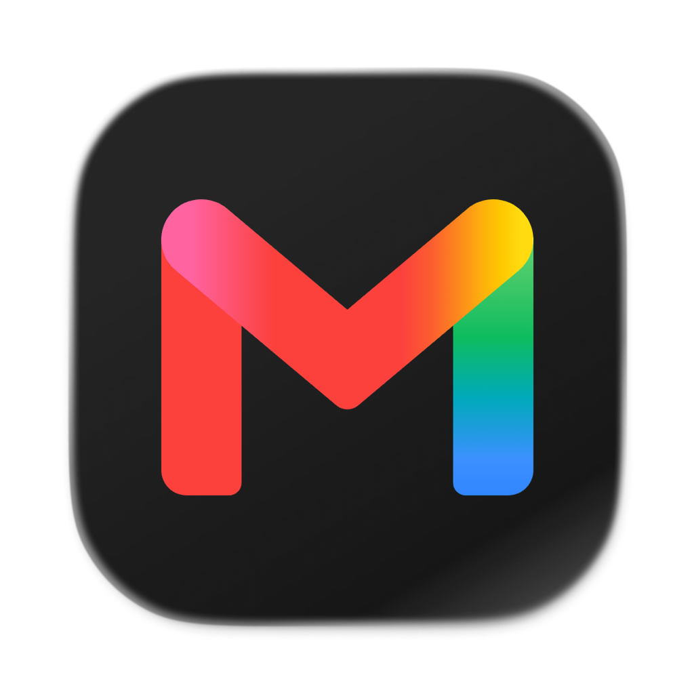

  

<h1 align="center">Needo</h1>

Tutti i tuoi account Gmail in una finestra sola, leggera e pensata per il Mac.

<a href="https://github.com/valerioceniccola/needo-mail/releases/latest"><b>Scarica Needo per Mac</b></a>

---

Needo è Gmail, quello vero, ma con ogni account al suo posto. Niente più schede del browser da cercare o account da cambiare dal menu in alto a destra: ogni casella ha la sua foto nella colonna a sinistra, e passi da una all'altra con un clic o con ⌘1, ⌘2, ⌘3.

E quando una casella non ti serve, la metti in pausa: niente notifiche, niente numeri rossi, finché non sei pronto.

## Cosa fa

- **Più account Gmail in una finestra.** Ognuno resta collegato per conto suo, con la sua foto e il suo colore.
- **Cambio veloce.** ⌘1 per il primo account, ⌘2 per il secondo e così via. L'ordine lo decidi tu trascinando le foto.
- **Pausa con un clic.** Tasto destro su un account › *Metti in pausa*. Resta in pausa finché non lo riattivi.
- **Pausa automatica.** Per ogni account puoi scegliere giorni e orari in cui va in pausa da solo, per esempio l'account di lavoro la sera e nel weekend.
- **Badge sull'icona.** Il numero sull'icona di Needo conta solo i non letti degli account attivi. Puoi anche decidere quali account contano.
- **Notifiche delle email nuove.** Con i pulsanti *Apri* ed *Elimina* direttamente nella notifica.
- **Si aggiorna da solo.** Quando esce una versione nuova, Needo te la propone.

## Installazione

1. [Scarica l'ultima versione](https://github.com/valerioceniccola/needo-mail/releases/latest): è il file `Needo-….dmg`.
2. Aprilo e trascina **Needo** nella cartella **Applicazioni**.
3. Apri Needo e premi **Aggiungi il primo account**: si apre la normale pagina di accesso di Google.

Serve un Mac con chip Apple (M1 o successivi).

## Come si usa

| Per… | Fai così |
|---|---|
| aggiungere un account | il **+** in fondo alla colonna a sinistra |
| passare da un account all'altro | clic sulla foto, oppure ⌘1…⌘9 |
| cambiare l'ordine | trascina le foto nella colonna |
| mettere in pausa o riattivare | tasto destro sulla foto |
| nome, colore, badge e pausa automatica di un account | tasto destro sulla foto › *Impostazioni…* |
| impostazioni generali | l'ingranaggio in fondo alla colonna |

Un account in pausa resta leggibile: lo apri, leggi, rispondi. Semplicemente non ti disturba.

## Privacy

Needo non ha server e non legge la tua posta. È un contenitore per la pagina di Gmail: l'accesso lo fai sulla pagina di Google, i dati restano tra il tuo Mac e Google, come quando usi Gmail nel browser. Rimuovendo un account da Needo se ne cancella anche la sessione.

## Domande frequenti

**È sicuro fare l'accesso a Google dentro Needo?**
La pagina di accesso è quella originale di Google. Needo non vede né salva le tue password, e il codice è pubblico: chiunque può controllarlo.

**Le notifiche non arrivano.**
Apri *Impostazioni di Sistema › Notifiche › Needo*, attiva *Consenti notifiche* e in *Stile avvisi* scegli *Permanenti*: così restano a schermo con i pulsanti Apri ed Elimina. Puoi arrivarci anche da Needo: Impostazioni › Notifiche di macOS › *Apri Impostazioni di Sistema*.

**"Elimina" cancella l'email per sempre?**
No, la sposta nel Cestino di Gmail, come il pulsante Elimina di Gmail. Dopo 30 giorni Gmail la cancella del tutto.

**Come lo tolgo?**
Trascina Needo dalla cartella Applicazioni nel Cestino.

---

Needo non è affiliato a Google. Gmail è un marchio di Google LLC. · [Novità](CHANGELOG.md) · [Per sviluppatori](docs/DEVELOPMENT.md) · [Idee future](docs/ROADMAP.md)
